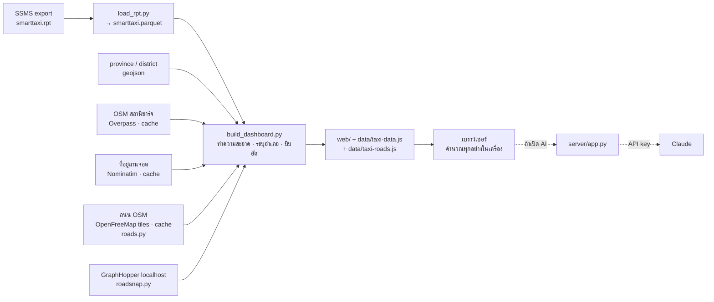

# EV7 Taxi Monitor — App Guide

คู่มือภาพรวมของเว็บ **Smart Taxi Monitor** ทั้งหมด: ทำอะไรได้ · แต่ละตัวเลขคำนวณจากอะไร · ใช้ ML/AI ตรงไหน (และตรงไหน *ไม่ได้* ใช้) · อะไรยาก · build / deploy ยังไง

แผนงานเดิม → [[EV7 Taxi Tracking Map]] · คำถามธุรกิจ → [[EV7 Taxi - Business Questions]] · ช่องว่างจาก spec → [[EV7 Taxi - Spec Requirements & Gap]] · ผู้ช่วยถามตอบ → [[EV7 Taxi - Q&A Assistant Design]] · ธุรกิจ → [[EV Business]]

เขียน 2026-10-22 · โค้ด `scripts/taxi/` (คู่มือ dev ละเอียด = `scripts/taxi/web/README.md`) · ข้อที่ยังไม่ยืนยันติด `[อนุมาน]`

> [!warning] ข้อมูลส่วนบุคคล
> ไฟล์ที่ build ออกมามี **ทะเบียน · VIN · ตำแหน่ง** ของรถที่ผูกกับคนขับ/ผู้เช่าซื้อ (PDPA) — ห้าม commit · ส่งเฉพาะคนที่มีสิทธิ์ · ถ้าขึ้นเซิร์ฟเวอร์ต้องอยู่หลัง VPN/SSO หรืออย่างน้อย basic auth + HTTPS

---

## 1. สรุป 1 นาที

- เว็บดูรถแท็กซี่ EV7 ทั้งฝูงบนแผนที่: **ตอนนี้อยู่ไหน · ใครออกนอกเขต · จอดค้างคืนที่ไหน · คันไหนวิ่งไปไหน** + ผู้ช่วยถามตอบภาษาไทย/อังกฤษ
- **ยังไม่ใช่ realtime** — ข้อมูลเป็นชุดที่ดึงครั้งเดียว (`smarttaxi.rpt` จาก SSMS) ช่วง **30 ก.ย. 10:48 – 1 ต.ค. 2026 15:29 (~29 ชม.)** · คำว่า "LIVE/ตอนนี้" ในเว็บ = จุดล่าสุดของข้อมูลชุดนั้น
  ระบบรองรับการอัปเดตอัตโนมัติไว้แล้ว (เช็กไฟล์ข้อมูลใหม่ทุก 60 วิ) — ขาดแค่ต้นทางข้อมูลที่อัปเดตจริง
- ทุกการคำนวณทำ **ในเบราว์เซอร์** จากไฟล์ข้อมูลที่ build ไว้ — ไม่ต้องมี database / server ก็เปิดได้ (ดับเบิลคลิก `index.html`)
- ส่วนใหญ่เป็น **กฎ (rules) ที่อธิบายได้** ไม่ใช่ ML · ML/AI ใช้ใน 3 จุด: ผู้ช่วยแบบ AI (Claude — ฝังไว้ ยังไม่เปิด) · ทดลอง forecast/anomaly (Chronos — นอกเว็บ) · โมเดลจำแนกคำถามที่เทรนใน notebook (ใช้เป็นต้นแบบของกฎ)

| | ตัวเลข (ข้อมูลชุดปัจจุบัน) |
|---|---|
| แถวดิบ → จุด GPS ใช้งาน | 1,391,444 → **1,172,487** |
| รถในระบบ / มีสัญญาณในช่วง | 4,145 / **3,649** คัน |
| ศูนย์ | `0a` · `yF` · `ux` (ยังไม่รู้ชื่อจริง) |
| ความถี่ GPS | ~ทุก 5 นาที · รถวิ่งเฉลี่ย **1.3 กม.** ระหว่าง 2 จุด |
| ไฟล์ที่ build | ข้อมูล 7.7 MB + เส้นทางตามถนน 11 MB (ไฟล์เดียว 19 MB) |

---

## 2. ข้อมูลไหลยังไง



**ทำความสะอาด** (`build_dashboard.py · clean()`)

| ปัญหา | จำนวน | ทำอะไร |
|---|---|---|
| API ส่งจุดเดิมซ้ำทุกรอบ (รถขาดสัญญาณ) | 209,348 | ตัดซ้ำด้วย `(vin, gps_time)` |
| จุดค้างเก่า | 566 | ตัด |
| เวลาเครื่องผิด (อนาคต) | 12 | ตัด |
| ไม่มี GPS fix (`signal = V`) | 23,988 | **เก็บไว้แสดง** แต่ไม่นับในการวิเคราะห์ตำแหน่ง/นอกเขต |

- คีย์รถ = **VIN** (car_id เดียวมีได้ 3 คันข้ามศูนย์) · ทะเบียนซ้ำ 4 ป้ายผูก 2 VIN → แสดงทะเบียน + ท้าย VIN 5 ตัว
- ทุกจุดถูกระบุ **อำเภอ/จังหวัด** ด้วย point-in-polygon (100% ของจุด)
- ความหมายคอลัมน์: `cm_meter` E = ว่าง · F = มีผู้โดยสาร `[อนุมาน]` · `cm_engine` 0 = ทำงาน · 1 = ดับ · 2 = ไม่ทราบ `[อนุมาน จากความเร็ว: ดับ = เฉลี่ย 0.2 กม./ชม.]` · `cm_battery` ยังไม่รู้

---

## 3. หน้าจอและฟังก์ชัน — แต่ละอย่างคำนวณจากอะไร

### 3.1 ค่าพื้นฐานที่ทุกส่วนใช้

| ค่า | ค่าตั้ง | ความหมาย |
|---|---|---|
| ออนไลน์ ณ เวลา T | จุดล่าสุด ≤ **15 นาที** ก่อน T | เก่ากว่านั้น = ออฟไลน์ |
| สถานะ | มีผู้โดยสาร (meter F) · ว่าง-วิ่ง (≥ **5 กม./ชม.**) · จอด · ไม่มีสัญญาณ | |
| "เวลา" ของแต่ละจุด | ถึงจุดถัดไปของคันเดียวกัน (สูงสุด 10 นาที) | ใช้รวมชั่วโมงออนไลน์ / มีผู้โดยสาร |
| ระยะทาง | ผลรวมระยะตรงระหว่างจุด ที่ห่างกัน ≤ 15 นาที และความเร็วคำนวณ < 160 กม./ชม. | ตัด GPS กระโดด · **ต่ำกว่าระยะวิ่งจริง** (เส้นตรง ไม่ตามถนน) |
| ช่วงขาด | ห่าง > **30 นาที** = คนละช่วง | |

### 3.2 แถบบน + Live / History

- **ตัวเลขด้านบน** (ออนไลน์ · มีผู้โดยสาร · ว่าง · จอด · นอกเขต) = สถานะของแต่ละคัน ณ เวลาที่ดูอยู่
- **LIVE** (ค่าเริ่มต้น) = เวลาล่าสุดของข้อมูล · ไม่มีแถบเวลา · รถออฟไลน์แสดงเป็นวงกลวงเทา ณ ตำแหน่งสุดท้ายที่รู้
- **History / Replay** = เปิดแถบเวลาด้านล่าง: กราฟรถออนไลน์ / มีผู้โดยสารทุก 10 นาที · ลากเลือกช่วง · กดเล่น (1/10/30 นาทีต่อวินาที)
- **Live test** (Map → Live test): ซ่อนชั่วโมงสุดท้ายของข้อมูล แล้วปล่อยเข้ามาตามนาฬิกาจริงเหมือน live (×1/×10/×60) · ทุกฟังก์ชันเห็นแค่ข้อมูลที่มาถึงแล้ว · ทุก 15 นาทีบันทึกคำทำนายแล้วเทียบของจริง (ผลดู 5.4)
- **Live เดินตามนาฬิกาจริง**: ต้นทางเก็บตำแหน่งทุกคันพร้อมกันทุก 5 นาที (เวลา :x4:30 / :x9:30) — หน้า Live จึงแสดงช้ากว่าข้อมูลล่าสุด 5 นาที (1 รอบ) และเดินตามเวลาจริง รถทุกคันวิ่งตามถนนระหว่าง 2 จุดที่มาถึงแล้ว ต่อเนื่องไม่หยุดรอรอบ และไม่เดาตำแหน่งล่วงหน้า · พอตามทันข้อมูลล่าสุดแล้วนาฬิกาหยุดรอข้อมูลรอบใหม่ (เปิดเป็นไฟล์ = ข้อมูลชุดตายตัว ป้ายบอก "Snapshot · no newer data" และมีปุ่ม Replay last hour)
- **Clear all**: ปุ่มบนหัวเว็บข้าง Ask กดครั้งเดียวกลับไปเหมือนเพิ่งเปิดหน้า — ล้างตัวกรองทุกที่ + รถที่เลือก + ช่วงเวลา/History (กลับ Live) + ไฮไลต์ + แชทผู้ช่วย (ค่าตั้งคงเดิม) · ถามผู้ช่วยเรื่องภาพรวม/พื้นที่ต่อจากถามรถรายคัน ระบบจะปล่อยรถคันก่อนเอง
- **อัปเดตเอง**: เมื่อเสิร์ฟผ่าน server เว็บเช็ก `data/taxi-data.js` ทุก 60 วิ (ETag/Last-Modified) ถ้าเปลี่ยน → โหลดใหม่ คงรถที่เลือกไว้ (จับด้วย VIN)

### 3.3 Overview

| การ์ด | คำนวณ |
|---|---|
| Active vehicles | รถที่มีจุดอย่างน้อย 1 จุดในช่วงที่เลือก |
| Time on trip | ชม.มีผู้โดยสาร ÷ ชม.ออนไลน์ (ทั้งฝูง) |
| Left the zone | รถที่มี "ทริปนอกเขต" ≥ 1 ครั้ง (ดู 3.5) |
| No GPS in period | รถในระบบ − Active |
| Where the fleet spends time | ชม.ออนไลน์รวมรายจังหวัด · คลิก = กรองจังหวัดนั้น |

### 3.4 Vehicles (รถรายคัน)

- ค้นหาทะเบียน/VIN · เรียงตามระยะทาง / ชม.มีผู้โดยสาร / จอด / ออฟไลน์
- เลือกจากรายการ → **แสดงคันเดียว** · คลิกบนแผนที่ → คันอื่นจางลง (สลับได้)
- **การ์ดรถ**: สถานะ ณ เวลานั้น · เคลื่อนที่ล่าสุดเมื่อไร · ระยะทาง · ชม.ออนไลน์/มีผู้โดยสาร/จอด · ความเร็วสูงสุด · กราฟความเร็ว · จังหวัดที่ผ่าน · ทริปนอกเขต · จุดจอด ≥ 30 นาที
- **เส้นทาง**: ทั้งช่วง / ถึงเวลาที่ดู / ย้อนหลัง 1–12 ชม. · 1–7 วัน · ลูกศรเล็กบอกทิศ ~12 ตัว · **วาดตามถนนจริง** (ดู 5.3)
  - **v4 (2026-11-10) แยกส่วนที่ผ่านแล้ว/ยังไม่ถึงด้วยลายเส้น**
    - **History**: เส้นทึบ = ส่วนที่รถวิ่งผ่านแล้วจนถึง cursor · เส้นประสีจาง = ส่วนที่รถยังไปไม่ถึง · ซ่อนเส้นคาดการณ์สีม่วงเมื่อมีเส้นทางจริงข้างหน้าแล้ว (เหลือแค่หมุด A/B)
    - **Live**: แสดงเฉพาะ **1 ชม. ล่าสุด เป็นเส้นประ** (ตัวเลือกช่วงเส้นทางใช้เฉพาะ History) · ค่าคงที่ `LIVE_TRACK_SEC` ใน `map/layers.js`
    - legend มีรายการเส้นทึบ/เส้นประของคันที่เลือก
  - **v5 (2026-11-11)** เส้นทางเป็น**สีชมพูบานเย็น** (`TRK_RGB` ใน `map/layers.js`) แทนสีน้ำเงินเข้มที่ดูเหมือนดำ · ส่วนที่เคยเป็นเส้นประเปลี่ยนเป็น**จุดเล็ก ๆ**
- **Trip — มาจากไหน ไปไหน**
  - *From* = จุดจอดล่าสุด (นิ่ง ≥ 30 นาที ในรัศมี 200 ม.) ก่อนเวลานั้น · *Now* = ตำแหน่ง + ทิศ + ระยะที่วิ่งมา
  - *Next stop* (โหมดย้อนหลัง) = จุดจอดถัดไป**จากข้อมูลจริง**
  - *Likely to* (ปลายข้อมูล) = **ประมาณ** จากจุดที่รถคันนี้เคยจอด ที่อยู่ในทิศที่กำลังวิ่ง (±40°, 0.8–60 กม.) ให้คะแนนตามจำนวนครั้ง/ระยะเวลา/เคยค้างคืน ÷ ระยะ · ความมั่นใจ low/medium
  - มีผู้โดยสาร → บอกได้แค่ทิศ (ปลายทางเป็นของผู้โดยสาร)
  - เส้นประไปจุดหมาย = เส้นทางตามถนน (OSRM) + ระยะ/เวลาโดยประมาณ (ไม่รวมรถติด)
- **Replay this trip** = ย้อนไปตอนออกจากจุดจอดแล้วเล่น แผนที่เลื่อนตามรถ

### 3.5 Out of zone (ออกนอกเขต)

- **เขตที่อนุญาต** 3 แบบ: **กรุงเทพฯ + ปริมณฑล (ค่าเริ่มต้นตั้งแต่ v5)** (นนทบุรี ปทุมฯ สมุทรปราการ นครปฐม สมุทรสาคร) · กรุงเทพฯ อย่างเดียว · กรุงเทพฯ + สุวรรณภูมิ (อ.บางพลี)
  - ค่าเริ่มต้นแบ่งเป็น 2 กลุ่ม: กรุงเทพฯ + ปริมณฑล กับ อื่น ๆ · ขอบแดง "นอกเขต" บนแผนที่และตัวเลข Left the zone ใช้นิยามนี้ · ลิงก์ `#zone=bkk` ยังเลือกเขตกรุงเทพฯ อย่างเดียวได้
- **ทริปนอกเขต** = ช่วงต่อเนื่องที่จุด GPS อยู่นอกเขต (จุดห่างกันไม่เกิน 30 นาที) ยาว ≥ 10 นาที (ปรับได้) · จุดไม่มีสัญญาณไม่นับ
- **ระดับ**: ต่างจังหวัด (ไปจังหวัดนอกเขตและนอกปริมณฑล) · ปริมณฑล · **อยู่นอกตลอด** (ไม่มีจุดในเขตเลยทั้งช่วง — มักเป็นรถที่บ้าน/ลานจอดอยู่นอกเขต)
- **ไม่นับเวลาในลานจอด** (ติ๊กได้) = ตัดจุดที่อยู่ในรัศมี 300 ม. ของลานจอด
- ตาราง + **CSV** (1 แถว = 1 ทริป) · ไกลสุด = ระยะตรงจากใจกลางกรุงเทพฯ
- ตัวเลขชุดนี้: เขตกรุงเทพฯ อย่างเดียว **3,128 คัน · 10,102 ทริป** · เขตปริมณฑล **579 คัน** — ความต่างมากนี้ชี้ว่า *การเลือกนิยามเขต* สำคัญกว่าตัวเลข

### 3.6 Outside (นอกเขต กทม. + ปริมณฑล เกิน X ชม.) — แทนแท็บ Parking ตั้งแต่ 2026-11-10

- **รายการรถที่ตอนนี้อยู่นอก กทม. + ปริมณฑล ติดต่อกันเกิน X ชม.** นับย้อนจากเวลาที่ cursor ของ timeline (Live = ตอนนี้) · ค่าเริ่มต้น **5 ชม.** · เลือก 1 ชม. / 5 ชม. / 24 ชม. / 5 วัน
- เขตคงที่ = กทม. + ปริมณฑล 5 จังหวัด (ไม่ขึ้นกับตัวเลือกเขตในแท็บ Out of zone)
- กติกาเดียวกับ alert LINE รายวัน ([[EV7 Taxi - Out-of-Zone Alert]]): นับจากจุดแรกที่ออกนอกเขต · ข้อมูลหายไม่รีเซ็ต · กลับเข้าเขตเมื่อเจอจุดในเขตติดกัน 2 จุด · จุดไม่มีสัญญาณไม่นับ · ใช้ประวัติทั้งหมดจนถึง cursor (ไม่ใช่แค่ช่วงที่เลือก)
- แต่ละแถว: ระยะเวลาที่อยู่นอกเขต · ทะเบียน · อำเภอ/จังหวัดล่าสุด · เริ่มนอกเขตเมื่อไร ("at least" = ไม่เคยเห็นในเขตเลยในข้อมูล) · ป้าย **No signal** ถ้าจุดล่าสุดเก่ากว่า 15 นาที · คลิก = ดูรถคันนั้น
- ตัวเลขบน rail = จำนวนคันที่เข้าเงื่อนไข · CSV 1 แถวต่อคัน · กราฟจังหวัดที่รถอยู่ (คลิก = กรอง)
- ชุดข้อมูลปัจจุบัน ณ 1 ต.ค. 15:25: **193 คันเกิน 5 ชม.** (ข้อมูลเริ่ม 30 ก.ย. จึงเกือบทุกคันเป็น "at least")
- โค้ด `web/js/ui/away.js`

### Parking (จอด · ค้างคืน · ตัดไฟ) — ถอดออกจาก rail แล้ว (โค้ด `ui/parking.js` ยังอยู่ · คืนได้ที่ `PANELS` ใน `ui/shell.js`)

- **จุดจอด** = นิ่งในรัศมี 200 ม. ≥ 30 นาที
- **ค้างคืน** = จุดจอดที่คร่อม 00:00–05:00 ≥ 1 ชม. (เลือกช่วงยาวสุดต่อคัน)
- **ลานจอด (depot)** = ≥ 5 คันค้างคืนในรัศมี 200 ม. เดียวกัน (density clustering ทั้งช่วงข้อมูล) → พบ **21 แห่ง · 456 คัน** · ที่อยู่ดึงจาก OpenStreetMap ตอน build
- **จอดตอนนี้แยกตามที่**: สถานีชาร์จ EV (≤ 80 ม. จากจุด OSM) · ลานจอด · **บ้าน** (จุดที่คันนี้เคยค้างคืน ≤ 200 ม.) · ริมถนน/อื่น ๆ
- **ตัดไฟได้ไหม** (decision support — เว็บ*ไม่*ส่งคำสั่ง) 2 แบบ:
  - *Basic*: จอดหรือเครื่องดับ ≥ 10 นาที + ไม่มีผู้โดยสาร + GPS สด (≤ 15 นาที) + จอดมาแล้ว ≥ 15 นาที
  - *Off-road* (ค่าเริ่มต้น): Basic + **ต้องอยู่นอกถนน**
  - เตือนเพิ่ม: จอดที่ชาร์จ (จะบังช่องชาร์จ) · เครื่องไม่รายงานว่าดับ
- **"นอกถนน" คิดยังไง** (ส่วนที่ต้อง normalize)
  - ตอน build: ระยะจากทุกจุดที่รถนิ่ง ถึง**ขอบถนน** (ระยะถึงเส้นกลาง − ครึ่งความกว้างตามประเภทถนน) จากข้อมูลถนน OSM · ไม่นับทางในลานจอด/ทางเข้าบ้าน · ไม่นับสะพาน/อุโมงค์ (ใต้ทางด่วนมักเป็นที่จอด)
  - ในเว็บ: ใช้ **มัธยฐาน** ของทุกจุดช่วงที่นิ่ง (พิกัดหลายจุดมีแค่ทศนิยม 4 ตำแหน่ง ≈ ±5.5 ม. + GPS คลาด 5–15 ม.) แล้วเผื่อ ±12 / 10 / 8 ม. ตามจำนวนจุด
  - ผล 3 ระดับ: บนถนน · **ขอบถนน (ไม่แน่ใจ → ไม่นับเป็นนอกถนน)** · นอกถนน
  - ชุดนี้: จุดนิ่ง 72% อยู่ ≤ 10 ม. จากขอบถนน · 15% ≥ 25 ม.

### 3.7 Areas

- ระบายสีจังหวัด/อำเภอตาม: จำนวนรถ · ชม.ออนไลน์ · ชม.มีผู้โดยสาร (สเกล log) · คลิก = กรอง

### 3.8 แผนที่

| สิ่งที่เห็น | ทำงานยังไง |
|---|---|
| จุด / ลูกศร | จอด = จุด · วิ่ง = ลูกศรตามทิศ GPS · สี: **ส้ม = มีผู้โดยสาร · เขียว = ว่าง · เทา = จอด** · ขอบแดง = นอกเขต · ขนาดตาม zoom (ซูมออกไกลเหลือจุดเล็ก) |
| 3D | เอียงแผนที่ + zoom ≥ 13 → แท็กซี่ 3D low-poly (สร้างในโค้ด ไม่มีไฟล์โมเดล) หันหน้าตามทางที่วิ่ง |
| รถเคลื่อนตอนเล่น | ตามเส้นทางตามถนนที่คำนวณไว้ (5.3) · ไม่มีเส้นทาง = อยู่ที่จุด GPS ล่าสุดแล้วกระโดดไปจุดถัดไป (ไม่ลากเส้นตรงตัดตึก) |
| สถานีชาร์จ | OpenStreetMap 306 จุด — **มีแค่บางส่วนของของจริง** (EVAT นับได้ ~3,400 สถานี ณ สิ้นปี 2567) ห้ามสรุปว่า "ไม่มีที่ชาร์จ" |
| แผนที่ฐาน | OpenFreeMap (ปกติ / ถนน + ตึก 3D) · Esri ดาวเทียม |
| ที่อยู่ | คลิกจุด → ที่อยู่จาก Nominatim (จำกัด 1 ครั้ง/วินาที · จำไว้ในเครื่อง) + ลิงก์ Street View / Google Maps |

### 3.9 ค้นหา · ตัวกรอง · ลิงก์

- ค้นหา: ทะเบียน · VIN · จังหวัด · อำเภอ · สถานที่ดัง (สยาม · สุวรรณภูมิ ฯลฯ) · พิมพ์ประโยค → ส่งให้ผู้ช่วย
- ตัวกรอง: ศูนย์ · สถานะ · พื้นที่ (กรุงเทพฯ / กรุงเทพฯ + ปริมณฑล)
- ลิงก์ตรง: `#panel=zone&zone=metro` · `#car=<id>` · `#area=metro` · `#view=3d` · `?ask=คำถาม`

---

## 4. ผู้ช่วยถามตอบ (Fleet assistant) — AI ใช้ยังไง

มี 2 โหมด สลับเองอัตโนมัติ

| | Offline (ค่าเริ่มต้น · ใช้งานอยู่) | AI agent (ฝังไว้ · ยังไม่เปิด) |
|---|---|---|
| ตีความคำถาม | **กฎ** (regex + gazetteer) ในเบราว์เซอร์ | Claude (`claude-opus-5-5`) ผ่าน `server/app.py` |
| ข้อมูลออกนอกเครื่อง | ไม่มี | คำถาม (ทะเบียนถูกแทนเป็นรหัส `car:<id>` ก่อนส่ง) + ผลสรุปจากเครื่องมือ — **ไม่มีทะเบียน/ตำแหน่งดิบ** |
| ตอบได้ | 8 intent + เวลาพีค + ช่วงข้อมูล | อิสระกว่า ผสมหลายเครื่องมือได้ |
| ต้องมี | — | server + `ANTHROPIC_API_KEY` (env เท่านั้น) |

- **8 intent** (เท่ากับโมเดลที่เทรนใน [[EV7 Taxi - Q&A Notebook (Kaggle)]]): รถในพื้นที่ · สถานะรถ · เส้นทางรถ · รถนอกเขต · ภาพรวม · สถานีชาร์จใกล้ · ขอสั่งการรถ (ปฏิเสธเสมอ) · นอกเรื่อง
- ทำไมใช้กฎแทนโมเดลที่เทรน: โมเดลใน notebook ใช้ sentence-transformers (Python) รันในเบราว์เซอร์ไม่สะดวก → แปลงเป็นกฎแล้ว**วัดกับชุดเทรนเดิม**: ถูก **99.6%** จาก 2,675 คำถาม · ชุดเขียนมือ 32/32 · ที่พลาดคือชื่อจังหวัดสั้นที่พิมพ์ผิด
- ผู้ช่วย **สั่งหน้าเว็บได้**: highlight รถ · วาดเส้นทาง · เลื่อนเวลา · เปิดแผง · แสดงสถานีชาร์จพร้อมเลขลำดับ
- ขอให้ตัดไฟ → ปฏิเสธ แต่บอกผลตรวจ "ตัดได้ปลอดภัยไหม" ของคันนั้น
- โหมด AI: server เป็น proxy ไร้สถานะ ถือแค่ API key → Claude ขอใช้เครื่องมือ → **เครื่องมือรันในเบราว์เซอร์** บนข้อมูลในหน้า → ส่งผลกลับ · ทดสอบ loop ครบแล้วด้วย Claude จำลอง · ยังไม่ได้ทดสอบกับ Claude จริง (ยังไม่มี key)

---

## 5. ML / การคำนวณขั้นสูง — ใช้ตรงไหน ใช้อะไร

| เรื่อง | วิธี | เป็น ML ไหม | สถานะ |
|---|---|---|---|
| ตีความคำถาม | กฎจาก template ที่ใช้เทรน | กฎ (ต้นแบบจาก ML) | ใช้ในเว็บ |
| จุดหมายที่คาด | คะแนนจากจุดจอดเก่าในทิศที่วิ่ง | heuristic | ใช้ในเว็บ |
| จอดที่ไหน / ตัดไฟได้ไหม | กฎ + ระยะถึงถนน (normalize) | กฎ | ใช้ในเว็บ |
| ลานจอด | density clustering | unsupervised (กฎ) | ใช้ในเว็บ |
| เส้นทางตามถนน | routing บนกราฟถนน OSM (GraphHopper) | อัลกอริทึม (ไม่ใช่ ML) | ใช้ในเว็บ (ตอน build) |
| ผิดปกติ / สาเหตุ / พยากรณ์ | Chronos-Bolt (time series foundation model) + top drivers | **ML** (pretrained) | ทดลองนอกเว็บ — `predictive_local.py` |
| ผู้ช่วย AI | Claude + tool use | **LLM** | ฝังไว้ ยังไม่เปิด |

### 5.1 ทดลองแบบ Databricks Predictive AI Functions (ต.ค. 2026)
ทำเทียบเท่า `ai_detect_anomalies` · `ai_top_drivers` · `ai_forecast` บนเครื่อง (`scripts/taxi/predictive_local.py`):
- **ผิดปกติ**: เจอ **ข้อมูลขาด** 30 ก.ย. 17:10 และ 19:40–19:50 + **สัญญาณเตือนก่อนขาด 10 นาที** (19:30 รถหายไป ~80 คัน)
- **สาเหตุตัวเลขเปลี่ยน**: รอบแรกได้ "ชม.มีผู้โดยสาร +20.6%" — **ผิด** เพราะวันแรกข้อมูลเริ่ม 11:30 · เทียบเฉพาะช่วงที่ครบ = **+2.4%** (กรุงเทพฯ +5% · ปทุมธานี −27%)
- **พยากรณ์ 4 ชม.**: Chronos ชนะ baseline เล็กน้อยกับรถออนไลน์ แพ้กับรถมีผู้โดยสาร — ข้อมูล 29 ชม. **น้อยเกินไป** ต้องสะสมหลายสัปดาห์
- บทเรียน: เครื่องมือบอก "ตรงไหน" ได้ แต่ต้องตรวจความครบของข้อมูลก่อนเสมอ

### 5.4 Live test — คำทำนายแม่นแค่ไหน (ชั่วโมงสุดท้าย 1 ต.ค. 14:29–15:29)
4 รอบ · 4,840 คำทำนาย (ประมาณจุดหมาย 1,546 · บอกแค่ทิศ 3,294)

| วัดอะไร | ผล |
|---|---|
| ตำแหน่งอีก 15 นาที — "อยู่ที่เดิม" (baseline) | คลาด median **3.4 กม.** |
| — "วิ่งตรงไปตามความเร็ว" | 6.7 กม. (แย่กว่า baseline — ถนนเลี้ยว/รถแวะ) |
| — "มุ่งไปจุดหมายที่ประมาณ" | 5.0 กม. เทียบ baseline 3.7 กม. ของกลุ่มเดียวกัน (แย่กว่า) |
| ทิศทางถูก (±45°) | **54%** (สุ่มเดา ≈ 25%) |
| ถึงจุดหมายที่ประมาณ (≤ 500 ม.) | **9%** · ใกล้สุด median 7.4 กม. |

สรุป: บอกทิศได้ดีกว่าเดา แต่ **ทำนายจุดหมายยังไม่แม่น** — ประวัติแค่ ~1 วัน (จุดจอดเก่าน้อย) · รถมีผู้โดยสารปลายทางขึ้นกับผู้โดยสาร · ทำให้ดีขึ้นได้ด้วยข้อมูลหลายสัปดาห์ + ทำนายตามเส้นถนน (GraphHopper) แทนเส้นตรง

### 5.2 ถ้าจะทำเป็น ML จริงในอนาคต
| โจทย์ | ต้องมีอะไรก่อน |
|---|---|
| จอดบ้าน/ที่ชาร์จ/ลานจอด (classifier) | **เฉลย**: ที่อยู่บ้านที่ยืนยันแล้ว · log การชาร์จจากผู้ให้บริการ · ผลการตัดไฟจริง |
| พยากรณ์ demand / รถออนไลน์ | ข้อมูลต่อเนื่อง ≥ หลายสัปดาห์ (เห็นรอบวัน/สัปดาห์/วันหยุด) |
| ETA / ปลายทาง | ประวัติทริปยาว ๆ + ข้อมูลจราจร |
| ผู้ช่วยฉลาดขึ้น | เปิดโหมด AI (มี API key + server) — ไม่ต้องเทรนเอง |

### 5.3 เส้นทางตามถนน — ทำไมยาก ทำยังไง
- GPS ทุก ~5 นาที รถวิ่งเฉลี่ย 1.3 กม. (60% เกิน 1 กม.) → ลากเส้นตรง = ตัดผ่านตึก ("รถบิน")
- วิธี: ต่อจุดที่รถเคลื่อนที่ (ตัดจุดจอดที่ขยับ < 60 ม.) แล้วหาเส้นทางตามถนนผ่านทุกจุดตามลำดับ → ได้เส้นทางระหว่างจุด
  - ลอง OSRM สาธารณะ: map matching ได้แค่ 10 จุด/ครั้ง (รถคันเดียว 300+ จุด) → ใช้ได้แค่คันที่เลือก
  - ใช้ **GraphHopper ของเราเอง** (ดู 6.2): ทุกคันใน ~90 วิ · ตามถนนได้ **93%** ของช่วง · ระหว่างเล่น 73–80% ของรถบนจอวางบนถนน
  - ช่วงที่ยาวเกิน 3 เท่าของระยะตรง + 1 กม. (จับผิดถนน) → ใช้แบบกระโดดจุดต่อจุดแทน
- ข้อจำกัด: เป็นเส้นทาง "ที่สั้นที่สุดระหว่างจุด" — ถ้ารถอ้อมจริงจะไม่ตรง · ไฟล์เส้นทาง 11 MB

---

## 6. Build · Deploy · ทำไมต้องมี Docker / GraphHopper

### 6.1 Build (ทำทุกครั้งที่มีข้อมูลใหม่)
```bash
python scripts/taxi/load_rpt.py                                  # .rpt → parquet
python scripts/taxi/build_dashboard.py --web D:\Taxi\dashboard_v5 --bundle D:\Taxi\Taxi_dashboard_v5.html
```
- `--web` = โฟลเดอร์ (deploy / เปิดในเครื่อง) · `--bundle` = HTML ไฟล์เดียว (ส่งต่อ)
- build ตรวจ syntax JS ทุกไฟล์ · ใส่ `?v=<hash>` กัน browser ใช้ไฟล์เก่า · ครั้งแรกดึงข้อมูลถนน (~10 นาที) ครั้งต่อไปใช้ cache
- คำว่า **"build"** ที่นี่ = เตรียมข้อมูล + รวมไฟล์เว็บ (ไม่ใช่ Docker build)

### 6.2 ทำไมต้องมีตัวคำนวณเส้นทาง (Docker / GraphHopper)
- ต้องคำนวณเส้นทางตามถนนให้รถ ~4,000 คัน (~10,000 request) → เซิร์ฟเวอร์สาธารณะไม่ให้ใช้หนักขนาดนั้น → **ต้องมีของตัวเอง**
- ตัวเลือก: **OSRM ใน Docker** (มาตรฐาน) หรือ **GraphHopper (Java)**
- เลือก **GraphHopper** เพราะ: เครื่อง dev ไม่มีสิทธิ์ admin (Docker/WSL ต้องใช้ + รีบูต) · Docker Desktop **ต้องเสียค่า license** ถ้าใช้งานในบริษัทใหญ่ · Java 17 มีอยู่แล้ว
- ข้อมูลอยู่ที่ `D:\Taxi\graphhopper\` (jar + แผนที่ไทย 330 MB) · ตั้งค่า `scripts/taxi/graphhopper/config.yml` · import ครั้งแรก 3.5 นาที · ฟังเฉพาะ `127.0.0.1:8989` · **ต้องเปิดก่อน build** (ไม่เปิด = build ผ่าน แต่รถกระโดดจุดต่อจุด)

### 6.3 Deploy (ขึ้นเซิร์ฟเวอร์)
- `scripts/taxi/server/app.py` (FastAPI): เสิร์ฟโฟลเดอร์ที่ build · basic auth (`EV7_USER` / `EV7_PASS`) · `/api/health` · `/api/agent` (proxy ไป Claude เมื่อมี `ANTHROPIC_API_KEY`)
- **Docker** ใช้ตรงนี้: `scripts/taxi/server/Dockerfile` แพ็ก server เป็น image เดียว ย้ายไปเครื่องไหนก็รันเหมือนกัน — **ไม่ bake ข้อมูลลง image** (mount โฟลเดอร์ตอนรัน เพราะมี PII)
- เซิร์ฟเวอร์ที่จะ build ข้อมูลตามรอบ ต้องมี Java + GraphHopper แบบเดียวกัน (หรือ OSRM Docker ถ้าเซิร์ฟเวอร์รัน Docker ได้)
- ห้ามใส่ API key / รหัส DB ในไฟล์หน้าเว็บ · ห้ามเปิด public

---

## 7. ข้อจำกัด · สิ่งที่ยาก · ต้องระวังเวลานำเสนอ

| เรื่อง | ผลกระทบ |
|---|---|
| ข้อมูล 29 ชม. ชุดเดียว | สรุปแนวโน้ม / รอบวัน-สัปดาห์ไม่ได้ · ML ส่วนใหญ่ยังทำไม่ได้ |
| GPS ทุก 5 นาที | ระยะทาง/เส้นทางระหว่างจุดเป็น**การประมาณ** · เส้นทางตามถนน = เส้นที่สั้นที่สุด |
| ทศนิยมพิกัด 2–4 ตำแหน่ง | ตำแหน่งคลาด ±5 ม. ถึง ±1 กม. → ต้องเผื่อทุกการตัดสิน "อยู่ตรงนี้ไหม" |
| ความหมายคอลัมน์ | meter / engine เป็นการอนุมานจากพฤติกรรม · battery ยังไม่รู้ · ชื่อศูนย์ยังไม่รู้ |
| ข้อมูลขาดเป็นช่วง | API มีช่วงที่ไม่ส่ง (เห็นชัด 2 ครั้งใน 30 ก.ย.) → ตัวเลขช่วงนั้นต่ำผิดจริง |
| นิยาม "เขต" | เปลี่ยนเขต ตัวเลขนอกเขตเปลี่ยน 3,128 → 579 คัน — ต้องตกลงกับธุรกิจก่อนใช้ตัดสิน |
| สถานีชาร์จ OSM ไม่ครบ | ใช้ดูภาพรวม ห้ามใช้สรุปว่าไม่มี |
| ตัดไฟ | เว็บเป็นแค่ตัวช่วยตัดสินใจ · คำสั่งจริงต้องผ่านระบบ telematics โดยคนที่มีสิทธิ์ |
| ประสิทธิภาพ | 1.17 ล้านจุดคำนวณในเบราว์เซอร์ — ลานจอดคำนวณเบื้องหลังแบบแบ่งชิ้น · ไฟล์เส้นทาง 11 MB โหลดหลังแผนที่ขึ้น |
| บริการภายนอก | แผนที่ฐาน (OpenFreeMap / Esri) · ที่อยู่ (Nominatim) · เส้นทางคันที่เลือก (OSRM) — ส่งแค่พิกัด ไม่มีทะเบียน · ใช้จริงควร self-host |

---

## 8. ทดสอบ

| เปิด | ตรวจอะไร |
|---|---|
| `index.html?selftest` | ตัวเลขวิเคราะห์ทั้งหมด — ต้องตรงกับรุ่นก่อน (ตรงทุกค่า ณ 22 ต.ค. 2026) |
| `?asktest` | ผู้ช่วยกับคำถามชุดเทรน |
| `?triptest` · `?roadtest` · `?layertest` · `?refreshtest` | trip/replay · เส้นทางตามถนน · จำนวนที่วาดบนจอ · การโหลดข้อมูลใหม่ |

---

## 9. คำถามที่ยังเปิด / งานต่อ

- [ ] ชื่อจริงของศูนย์ `0a` · `yF` · `ux` · ความหมาย `cm_battery` · ยืนยัน `cm_engine` / `cm_meter`
- [ ] ต้นทางข้อมูลแบบ realtime (API / ตารางที่อัปเดตตามรอบ) → ต่อที่ `js/data/source.js` + build ตามรอบ
- [ ] ตกลงนิยาม "เขตที่อนุญาต" และกติกาตัดไฟกับฝ่ายธุรกิจ/กฎหมาย
- [ ] เซิร์ฟเวอร์ deploy (VPN/SSO) + GraphHopper/OSRM บนเซิร์ฟเวอร์ · ตัดสินใจเรื่อง Claude API key
- [ ] เก็บเฉลยสำหรับ ML (บ้าน · การชาร์จ · ผลตัดไฟ) และสะสมข้อมูลหลายสัปดาห์
- [ ] ยังไม่ได้ commit โค้ดชุดนี้
